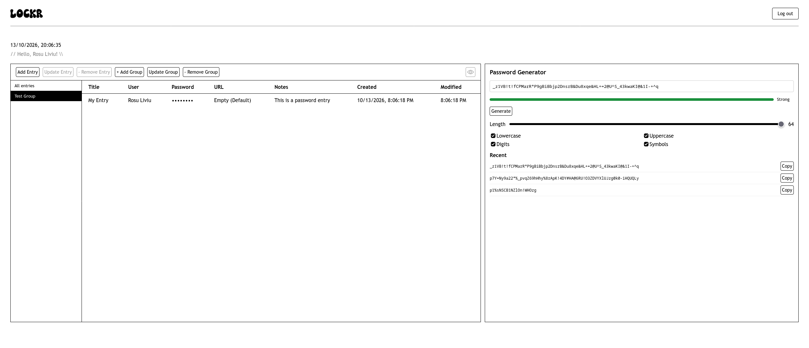
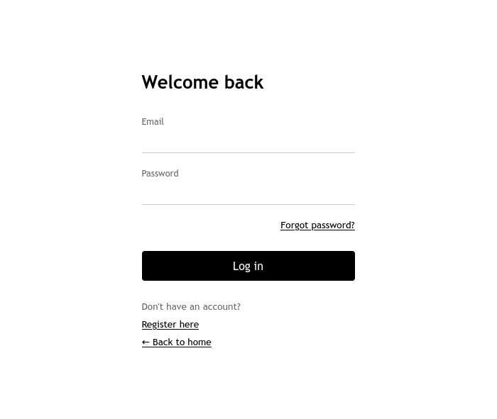
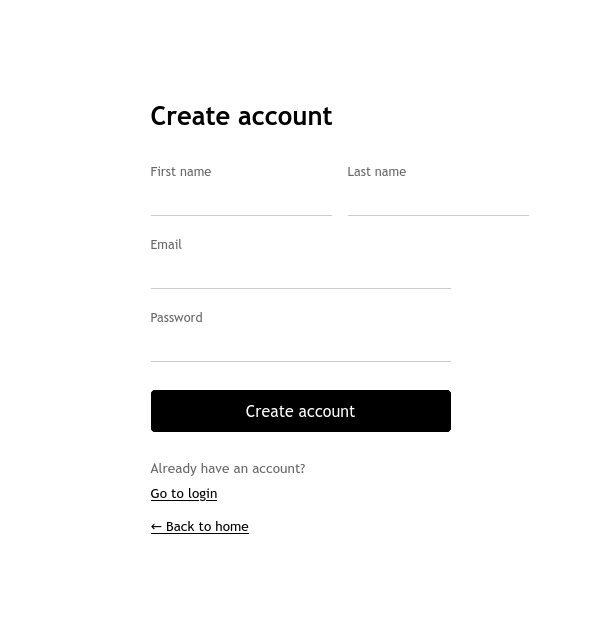

# 🔐 Lockr

**Lockr** is a password management web app that helps you organize account credentials in one place. Create password entries, group them by category, and generate strong passwords with the built-in password generator.

## 🏗️ System Architecture

Lockr follows a **monolithic architecture**, with the application's core functionality managed within a single backend application.

The backend handles authentication, password entry management, group management, database interactions, and password-related operations. The React frontend provides the user interface for managing credentials and organizing them into groups.

## ✨ Features

- **Password entries** — Store credentials with a title, username, password, URL, and notes.
- **Groups and categories** — Organize related entries into groups, making credentials easier to find.
- **Password generator** — Generate passwords with configurable length and character sets, including lowercase letters, uppercase letters, digits, and symbols.
- **Password strength indicator** — View a strength indicator for generated passwords.
- **Recent generated passwords** — Review recently generated passwords and copy them when needed.
- **Entry management** — Add, update, and remove password entries.
- **Group management** — Create, update, and remove groups.
- **Account management** — Register an account, log in, and log out.

## 👀 Sneak Peek

The screenshots below are stored in the `assets/` directory.

| 🏠 Dashboard | 🔓 Login | 📝 Registration |
| --- | --- | --- |
|  |  |  |

## 📋 Prerequisites

Before running Lockr, make sure you have:

- ☕ **Java 21 or higher**
- 🐘 **A running PostgreSQL database**
- 📦 **npm**

## 🚀 Installation

### 1. Clone the repository

```bash
git clone https://github.com/Lipiu/lockr.git
cd lockr/
```

### 2. Configure the backend

Create an `.env.properties` file in the root of the `backend/` directory.

Add the following properties, replacing the placeholders with your actual values:

```properties
DB_URL=jdbc:postgresql://localhost:5432/your_database
DB_USERNAME=your_database_username
DB_PASSWORD=your_database_password
app.encryption.key=your_base64_encoded_encryption_key
```

🔒 **Security notes:**

- Generate a cryptographically secure **256-bit (32-byte)** encryption key 
    - Eg: openssl rand -base64 32
- Confirm that Spring Boot is configured to load `.env.properties`; it is not automatically loaded just because the file exists.

### 3. Start the Spring Boot backend

Open a terminal and navigate to the backend directory:

```bash
cd backend/
./mvnw spring-boot:run
```

On Windows, you may need to use:

```powershell
.\mvnw.cmd spring-boot:run
```

### 4. Start the React frontend

Open a **second terminal** from the repository root and run:

```bash
cd frontend/
npm install
npm run dev
```

🌐 Open the local URL printed in the terminal to use Lockr.

## 🧭 Usage

1. **Create an account** or log in.
2. **Create a group** for a category, such as Personal, Work, or Development.
3. **Add a password entry** with its title, username, password, URL, and any useful notes.
4. **Organize entries** by assigning them to the appropriate group.
5. **Generate a password** and adjust the length and character options to suit your needs.
6. **Copy a generated password** from the recent-password list when needed.
7. **Update or remove** entries and groups as your needs change.

## 🛠️ Tech Stack

| Layer | Technologies |
| --- | --- |
| Frontend | React 19.3, TypeScript, Vite 8.3.4, CSS |
| Backend | Java 21+, Spring Boot 4, Spring Security, Spring Data JPA, Hibernate |
| Database | PostgreSQL |
| Database tool | DBeaver |

## 📁 Project Structure

```text
Lockr/
├── backend/                 # Spring Boot backend
├── frontend/                # React + Vite frontend
├── assets/                  # Application screenshots
└── README.md
```

## 🔒 Security

Lockr manages sensitive credential data, so secure configuration and deployment are important.

- Keep encryption keys and database credentials out of source control.
- Use HTTPS in production.
- Store account passwords using a suitable password-hashing algorithm.
- Protect stored credentials with encryption appropriate to the application's design.
- Never log passwords, encryption keys, or other sensitive data.
- Keep dependencies updated.

The actual security guarantees depend on the application's implementation and configuration.

## Contributing

Contributions and suggestions are welcome!

1. Fork the repository.
2. Create a branch for your changes.
3. Make and test your changes.
4. Open a pull request with a clear description of your update.
